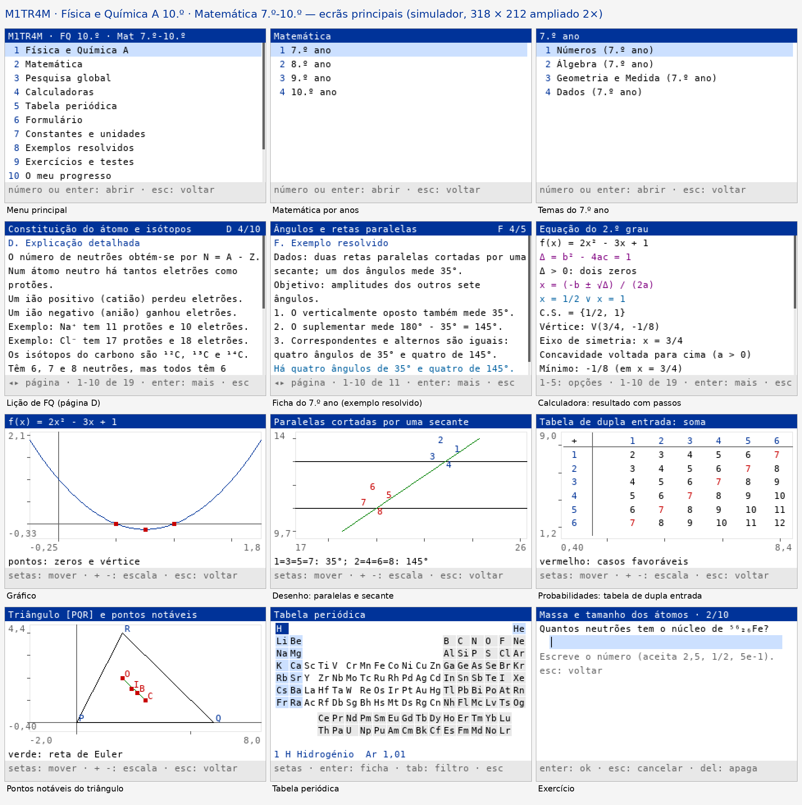

# M1TR4M

App de estudo para a **TI-Nspire CX II-T**, em Python (MicroPython): **Física
e Química A do 10.º ano** e **Matemática do 7.º ao 10.º ano**. by M1TR4M.



> **Estado:** tudo foi testado no computador (simulador, CPython e
> MicroPython 1.12 de 32 bits). Nada foi ainda corrido numa calculadora.
> A lista do que falta confirmar no aparelho está em
> [docs/TESTES_NO_APARELHO.md](docs/TESTES_NO_APARELHO.md).

## O que tem

- **33 temas**: 14 de Física e Química A (6 de Química, 3 de Física, 2 de
  atividades laboratoriais com as 13 AL e 3 de revisões do 7.º ao 9.º ano) e
  19 de Matemática (4 por ano do 7.º ao 9.º e 7 do 10.º ano).
- **155 lições**, **270 fórmulas**, **99 exemplos resolvidos** (3 níveis) e
  **313 exercícios** com correção, pista e resolução.
- **103 calculadoras** com fórmula, substituição e resultado (e passos):
  7 comuns, 44 de FQ (11 delas assistentes das AL) e 52 de Matemática.
- Pesquisa global, tabela periódica, formulário, constantes, teste do
  capítulo, revisão rápida com cartões, progresso e definições.

## Ficheiros para a calculadora (`dist/tns`)

| Ficheiro | Para quê |
| --- | --- |
| `M1TR4M.tns` | A app inteira num só documento (114 módulos). Forma preferida. |
| `PyLib/*.tns` | 113 ficheiros, um por módulo, para a pasta PyLib. |
| `M1TR4M_arranque.tns` | Documento pequeno que arranca a app instalada na PyLib. |
| `M1TR4M_sonda.tns` | Sonda (Fase 0): mostra o que a calculadora aguenta. Corre-a primeiro. |
| `M1TR4M_FQ.tns`, `M1TR4M_Mat.tns` | Edições de reserva, cada uma num só programa (até 300 KB). |

As edições de reserva também estão em `dist/edicoes` como `.py`.

## Instalar

Há um guia passo a passo em PDF:
[docs/INSTALAR_NA_CALCULADORA.pdf](docs/INSTALAR_NA_CALCULADORA.pdf).

Precisas do **TI-Nspire CX II Connect** (ou do TI-Nspire Computer Link) e de
um cabo USB. O Python precisa do sistema operativo 5.2 ou posterior.

1. **Sonda.** Copia `M1TR4M_sonda.tns` para a calculadora. Abre-o, vai à
   página do `m1sonda.py` e corre-o (ctrl+R). Fotografa o ecrã. Depois
   carrega em teclas para ver os nomes; esc duas vezes sai.
2. **Um só documento (forma preferida).** Copia `M1TR4M.tns`, abre-o e corre
   o `m1.py`. Funciona se a calculadora deixar um programa importar outro do
   mesmo problema (a sonda diz isso na linha "import").
3. **PyLib (se a forma 2 falhar).** Copia os 113 ficheiros de `dist/tns/PyLib`
   para a pasta **PyLib** da calculadora. Depois abre `M1TR4M_arranque.tns` e
   corre o `m1.py`.
4. **Edições de reserva.** Se nenhuma das formas anteriores arrancar, usa
   `M1TR4M_FQ.tns` ou `M1TR4M_Mat.tns`. Cada uma é um só programa e não
   precisa de mais nada. Têm menos conteúdo: a de FQ só tem os 9 temas do
   10.º ano (38 calculadoras); a de Matemática só tem o 7.º, o 8.º e o 9.º
   ano (35 calculadoras). Nenhuma tem pesquisa.

O Diagnóstico (menu principal ▸ 12 ▸ Diagnóstico ▸ Resumo do aparelho) diz
qual forma está a funcionar ("Importação: documento" ou "PyLib") e quanta
memória está livre.

## Usar

| Tecla | Ação |
| --- | --- |
| número | escolhe a opção; com 10 ou mais opções, "1" e depois "2" escolhe a 12 (e "1" e enter escolhe a 1) |
| ▴ ▾ | mudam a opção ou deslizam o texto |
| ◂ ▸ | página anterior ou seguinte |
| enter | confirma; num texto longo, avança |
| esc ou 0 | volta ao ecrã anterior |
| del / clear | apaga um carácter / limpa o campo |
| shift / tab | uma maiúscula / fixa as maiúsculas |

Nas calculadoras, se um campo tem várias unidades, ▾ leva à unidade e ◂ ▸
mudam-na. O rodapé de cada ecrã diz o que fazem enter e esc.

**Gravar.** A app guarda as definições e o progresso em variáveis do
documento. Para ficarem guardados de vez, grava o documento com **ctrl+S**
antes de o fechar.

**Sair.** Menu principal ▸ 13 (Sair), ou esc no menu principal; depois
confirma.

**Modo de exame.** No Press-to-Test os documentos ficam inacessíveis. A
M1TR4M não tenta contornar isso: é para estudar fora dos testes.

As limitações conhecidas estão em [docs/limitacoes.txt](docs/limitacoes.txt)
(e no ecrã "Sobre a M1TR4M").

## Para quem desenvolve

```
src/            núcleo (m1*.py), calculadoras (calc/c_*.py) e sonda
conteudo/       lições, fórmulas, exemplos e exercícios (fq/, mat/)
dados/          tabela periódica e constantes (CSV com a fonte de cada valor)
ferramentas/    build, verificação, edições, prévia, simulador e percursos de teclas
testes/         testes unitários (correm em CPython e MicroPython)
dist/           módulos gerados, .tns, edições de reserva, capturas e prévia
docs/           plano, limitações e testes no aparelho
```

**Build** (para no primeiro erro):

```
sh ferramentas/prepara.sh              # uma vez: MicroPython 1.12 (32 bits), mpy-cross e Luna
python3 ferramentas/build.py           # build completo
python3 ferramentas/build.py --rapido  # sem as medições de memória por bisseção
```

O build valida os conteúdos e recalcula cada número marcado, gera os módulos
ASCII, verifica o código, corre os testes nos dois Pythons, mede a memória,
corre os percursos de teclas no simulador, gera as edições de reserva, cria os
`.tns` (conferindo cada `.py` byte a byte) e escreve `dist/build.json` e
`dist/previa.png` (esta precisa do Pillow).

**Simulador:** `python3 ferramentas/simulador/correr.py ferramentas/teclas/p01_fq_licao.txt --src dist/py --texto`
corre um percurso de teclas e escreve cada ecrã.

O formato dos conteúdos está descrito no início de `ferramentas/conteudo.py`.

## Documentos

- [RELATORIO.md](RELATORIO.md): relatório final (compatibilidade, código,
  conteúdos, funcionalidades, instalação e testes).
- [CHANGELOG.md](CHANGELOG.md): registo de alterações.
- [docs/TESTES_NO_APARELHO.md](docs/TESTES_NO_APARELHO.md): lista de testes
  para fazer na calculadora.
- [docs/PLANO.md](docs/PLANO.md): plano de trabalho e módulos.
